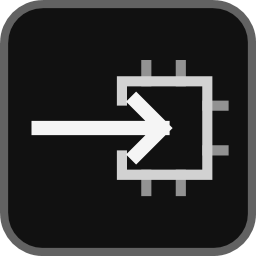
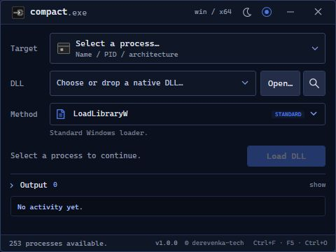

<div align="center">



# Compact Loader

Компактный загрузчик нативных DLL для Windows.<br />
C# · WPF · .NET 10 · x64 / x86

[](https://github.com/bronemishka/compactloader/actions/workflows/build.yml)
[](https://github.com/bronemishka/compactloader/releases/latest)

**[Скачать x64](https://github.com/bronemishka/compactloader/releases/latest/download/CompactLoader-win-x64.exe)** · **[Скачать x86](https://github.com/bronemishka/compactloader/releases/latest/download/CompactLoader-win-x86.exe)** · **[Все релизы](https://github.com/bronemishka/compactloader/releases)**

<br />



<sub>Реальное окно версии 1.0.0 · тёмная тема · системный акцент Windows</sub>

</div>

---

[Быстрый запуск](#быстрый-запуск) · [Методы](#методы-загрузки) · [Оформление](#интерфейс-и-оформление) · [Сборка](#сборка) · [Тесты](#тесты-и-ci) · [Техническая документация](docs/technical.md)

## Возможности

- Пять методов загрузки: **LoadLibraryW**, **LdrLoadDll Stub**, **Thread Hijacking**, **Manual Map**, **LdrpLoader**.
- Список процессов с иконками, поиском по имени/PID и фильтром основных окон.
- Drag-and-drop DLL, история файлов и просмотр PE-метаданных через кнопку с лупой.
- Проверка архитектуры, типа PE и повторной загрузки; диалог результата в теме приложения.
- Журнал с предпросмотром последней строки, копированием, сохранением и очисткой.
- Светлая/тёмная тема, системный акцент Windows и пользовательский HEX/RGB.
- Стандартный WPF без сторонних NuGet-зависимостей и UI-пакетов.

## Быстрый запуск

1. Скачай EXE нужной архитектуры и установи **.NET 10 Desktop Runtime** той же архитектуры. Runtime не включён в EXE.
2. Выбери процесс в поле **Target**.
3. Укажи нативную DLL через **Open…**, перетаскиванием или из истории. Лупа читает метаданные без выполнения DLL.
4. Выбери **Method**. Для обычной нативной DLL начни с **LoadLibraryW**.
5. Нажми **Load DLL** — результат появится в отдельном диалоге и в **Output**.

Приложение, DLL и целевой процесс должны иметь одинаковую архитектуру: **x64 либо x86**. Обычная C# DLL не подходит: приложение не запускает управляемые методы. Запуск от администратора по умолчанию не нужен; для процесса с повышенными правами нужны соответствующие права.

> **Таймаут — неизвестный результат.** Ожидание ограничено 15 секундами. Не повторяй загрузку вслепую: целевой поток может продолжать использовать выделенную память.

## Методы загрузки

| Метод | Как работает | Что учитывать |
| --- | --- | --- |
| **LoadLibraryW** | Системный загрузчик через новый удалённый поток | Основной вариант для обычных нативных DLL |
| **LdrLoadDll Stub** | `ntdll!LdrLoadDll` через stub x64/x86 | Ограничения динамического кода могут запрещать запуск |
| **Thread Hijacking** | Перенаправление существующего потока с восстановлением контекста | Возможны зависания или ошибки целевого приложения |
| **Manual Map** | Размещение PE, релокации, импорты и вызов точки входа | Экспериментальный метод; ограниченная поддержка PE, выгрузки нет |
| **LdrpLoader** | Отдельный вызов приватного `ntdll!LdrpLoadDll` с подготовкой пути и освобождением временной ссылки | Экспериментальный; только x64, сборка ОС 26300 и проверенный бинарник `ntdll.dll` 10.0.26100.9549 |

LdrpLoader привязан к SHA-256 конкретного `ntdll.dll`; другой файл, неподходящая архитектура или изменённые проверяемые участки функций приводят к отказу до записи в процесс. После обновления Windows метод может стать недоступным. Символы и сторонние библиотеки во время работы приложения не требуются. Метод проверен на Windows 26H2, сборка 26300.9711, только на собственных нативных фикстурах; совместимость с произвольными DLL не гарантируется.

<details>
<summary><strong>Ограничения Manual Map и повтор после ошибки</strong></summary>

Не поддерживаются статический TLS/TLS callbacks, delay-load imports, x86 SafeSEH и Guard CF/XFG load configuration. Образ не регистрируется в системных списках загрузчика, поэтому `GetModuleHandle` и thread notifications не работают как при обычной загрузке.

Таблицы импортов и релокаций проверяются до выделения памяти в целевом процессе: повреждённые дескрипторы, RVA, ordinal и блоки релокаций отклоняются заранее. Релокации проверяются и при доступном предпочтительном адресе образа.

Если точка входа уже была вызвана, удалённый вызов завершился таймаутом или очистка не удалась, образ может остаться в процессе. Повтор блокируется в текущем сеансе. **Перед повтором перезапусти целевой процесс** — перезапуска CompactLoader недостаточно. Зависимости могут остаться с удержанными ссылками и после ошибки.

Подробности всех методов, проверки PE и правила работы с удалённой памятью — в [технической документации](docs/technical.md).

</details>

## Интерфейс и оформление

Окно фиксировано на **480×360**. Список процессов открывается выпадающей панелью. Кнопка Output со счётчиком открывает отдельное изменяемое по размеру окно справа от основного (у края экрана положение ограничено рабочей областью). Закрытие Output скрывает окно и сохраняет журнал до завершения приложения. В основном окне остаётся предпросмотр последней строки фиксированной высоты; открытие журнала не добавляет прокрутку. Чтение DLL, файловые проверки, настройки, сохранение журнала, перечисление процессов и загрузка выполняются вне UI-потока.

| Клавиши | Действие |
| --- | --- |
| `Ctrl+F` | Открыть список процессов и перейти в поиск |
| `F5` | Обновить список процессов |
| `Ctrl+O` | Выбрать DLL |
| `Enter` / `Escape` | Подтвердить / отменить выбор в списке процессов |

В верхней панели доступны светлая/тёмная тема и акцент: **Windows**, Green, Blue, Cyan, Amber, Violet, Coral или **Custom color** с HEX/RGB. Режим Windows следует за системным цветом без перезапуска. Шрифт — Cascadia Mono с запасным Consolas.

Настройки хранятся в `%LOCALAPPDATA%/CompactLoader/`: `appearance.json` — оформление, `session.json` — история DLL и фильтр списка.

## Сборка

Нужны **Windows и .NET 10 SDK**. Для Rider / Visual Studio достаточно открыть `CompactLoader.csproj`.

```powershell
# x64
dotnet publish .\CompactLoader.csproj -c Release -r win-x64 -p:Platform=x64 --self-contained false -p:IncludeNativeLibrariesForSelfExtract=true -o .\publish\x64

# x86
dotnet publish .\CompactLoader.csproj -c Release -r win-x86 -p:Platform=x86 --self-contained false -p:IncludeNativeLibrariesForSelfExtract=true -o .\publish\x86
```

Результат — `CompactLoader.exe` в `publish/x64` или `publish/x86`. Single-file не включает Desktop Runtime. Trimming отключён для WPF; self-contained сборка будет существенно больше из-за включённого runtime.

## Тесты и CI

```powershell
# x64
dotnet run --project Tests/Validation/Validation.csproj --runtime win-x64 -p:Platform=x64

# x86
dotnet build Tests/Validation/Validation.csproj --runtime win-x86 -p:Platform=x86
& "C:/Program Files (x86)/dotnet/dotnet.exe" Tests/Validation/bin/x86/Debug/net10.0-windows/win-x86/Validation.dll
```

Тесты создают и завершают только собственные нативные процессы-фикстуры. Проверяются методы загрузки, импорты, релокации, результат `DllMain`, продолжение исходного потока и пропуск повтора. Для Manual Map также проверяются отказ для TLS, повреждённая x64 exception table и блокировка повтора после неудачной инициализации. LdrpLoader выполняется только на поддерживаемом бинарнике x64: дополнительно проверяется отказ `DllMain`; в остальных окружениях проверяется явный отказ метода, а сценарий выполнения пропускается.

[GitHub Actions](https://github.com/bronemishka/compactloader/actions/workflows/build.yml) запускает тесты и собирает EXE отдельно для x64/x86 при push в `main`, pull request, отправке тегов `v*` и вручную. Тесты обеих архитектур прошли в CI релиза 1.0.0 на Windows Server 2025. Целевая платформа — Windows 11; CI на Windows Server не заменяет её отдельную проверку.

<details>
<summary><strong>Как выпустить новую версию</strong></summary>

1. Обнови `Version` в `CompactLoader.csproj` — подпись в окне берётся из версии сборки.
2. Добавь заметки в `.github/release-notes/v<версия>.md`.
3. Зафиксируй изменения и отправь тег `v<версия>`, совпадающий с `Version`.
4. После успешных тестов обеих архитектур workflow создаст GitHub Release с двумя EXE и `SHA256SUMS.txt`.

</details>

## Устройство проекта

| Каталог | Назначение |
| --- | --- |
| `Views/` | Главное окно, диалог результата и редактор цвета |
| `Presentation/`, `Themes/` | Оформление, настройки, стили и данные списка процессов |
| `Models/`, `Services/` | Модели, каталог процессов, проверки и PE-инспектор |
| `Loading/`, `Interop/` | Методы загрузки, работа с PE и WinAPI |
| `Tests/Validation/` | Нативные PE-фикстуры и интеграционные проверки |
| `Assets/`, `Tools/IconGenerator/` | Иконка, скриншот и экспорт ICO из XAML |

[Подробности реализации и ограничения](docs/technical.md) · [LoadLibraryW](https://learn.microsoft.com/en-us/windows/win32/api/libloaderapi/nf-libloaderapi-loadlibraryw) · [Формат PE](https://learn.microsoft.com/en-us/windows/win32/debug/pe-format)
